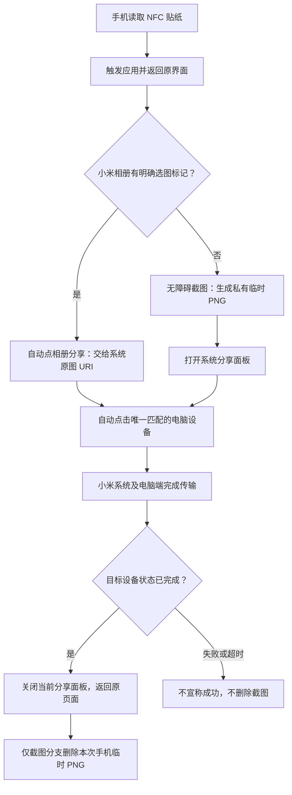

# 不同设备适配与 Agent 操作指南

[返回项目首页](../README.md)

这份指南面向想在自己手机和电脑上复现的人，以及协助适配的 AI Agent。以下“已验证”均限于项目首页记录的环境；表中“可评估”表示工程方向，不代表兼容认证。

**项目的主要目标是非小米 Windows 台式机 / 组装机。** 小米/REDMI 笔记本已有适用的官方互联功能时，直接使用原生方案，不需要跟随本项目重新搭建。其他电脑类型仅在本指南讨论额外适配边界。

## 1. 原理：贴纸只是启动按钮

NFC 贴纸保存自定义 URI 和指向本应用包名的 Android Application Record（AAR）。手机读到后，Android 按 URI 找到本应用的触发入口。贴纸不存照片，也不把照片通过 NFC 传给显示器；显示器只是粘贴位置，电脑无需为这张被动标签增加 NFC 读卡器。[Android NFC 标签分发说明](https://developer.android.com/develop/connectivity/nfc/nfc)



三个层次分别适配：**触发**是 NFC URI；**操作**是 Android 无障碍读取控件并点击；**传输**是已有的小米系统分享和电脑接收服务。传输使用系统选定的连接，本应用的日常路径不自己实现 Wi-Fi/蓝牙协议。

截图调用 Android 11（API 30）新增的 `AccessibilityService.takeScreenshot`，需服务声明截图能力并由用户启用；原型 manifest 的 minSdk=26 不表示 Android 8 就支持截图。[Android 截图 API](https://developer.android.com/reference/android/accessibilityservice/AccessibilityService#takeScreenshot(int,%20java.util.concurrent.Executor,%20android.accessibilityservice.AccessibilityService.TakeScreenshotCallback))

## 2. 先判断你的组合属于哪种情况

| 设备组合 | 当前状态与建议 |
| --- | --- |
| Xiaomi 15 + README 中的已测系统 + 能手动收图的 Windows 电脑 | 已验证自动分享及实体 NFC；用户反馈断开调试后正常，仍需在自己的环境复测 |
| 其他小米 / Redmi、其他 HyperOS / MIUI 版本 | 可优先评估。先确认系统相册手动分享，随后重新采集选择标记、设备行和完成状态 |
| 非小米 Windows 台式机 / 组装机 | **本项目主要目标。** CPU、主板型号不是充分判据；先用官方 Windows 互联服务完成手动收图 |
| 小米 / REDMI 笔记本 | 不属于目标用户；已支持官方互联/一碰传的机型直接使用原生功能 |
| 其他品牌 Windows 笔记本 | 额外适配场景，不作为主要教程对象；需独立验证接收软件和手动传图 |
| macOS / Linux 电脑 | 本仓库没有此类接收环境的实测。若不能出现在现有系统分享设备栏，需要另行设计传输/接收路径 |
| 非小米 Android 手机 | NFC 与无障碍是可研究的基础，但当前小米相册包名及设备资源 ID 不通用，需要重新适配；不能只改设备名就保证可用 |
| iPhone | 本 Android APK 无法安装使用。需要单独的 iOS 方案，本仓库没有实现 |
| Android 手机无 NFC | 不能用实体贴纸触发；可单独评估手动按钮/快捷入口，不能称为一碰即传 |
| 手机无法允许无障碍或截图 | 对应自动操作/截图能力不可用；不能通过普通 ADB 检测命令替代系统授权 |

电脑不一定必须买同品牌，但也不能承诺任何电脑都能装好就用。**先手动传一张图成功，再做自动化。** 不要为了本项目先替换现有可用系统组件。

## 3. 初次复现：按顺序做

### 第一步：验收原生手动发送

尚未配置电脑端和手机互联？先完成 **[手机与电脑互联配置教程](SETUP.md)**。其中包含官方软件下载入口、不同电脑选哪个版本、手机开关、配对及接收目录确认。

在手机自带相册选一张普通测试图 → 分享 → 点击目标电脑。确认电脑真实收到文件，记录系统显示的设备名称（包括换行）。再测试多张图片。

手动失败时，先排查接收软件、账号/配对要求、设备发现、网络和电脑权限。VPN 是否影响取决于它对本地网络的路由设置，不能仅因开着 VPN 就判定原因。手动都失败时，停止自动点击适配；自动化无法修复底层不通的传输。

### 第二步：准备调试连接和构建环境

- 使用支持数据传输的 USB 线，手机解锁。
- 用户手动开启开发者选项和 USB 调试，确认手机上的电脑 RSA 授权弹窗。
- 运行 `adb devices -l`，状态应为 `device`。`unauthorized` 需要手机授权；`offline` 要检查连接。是否自动弹出文件管理器不能用作 ADB 成功判据。
- 按 README 配置 Python、JDK 17、Android SDK 工具。当前构建脚本适用于 Windows；macOS / Linux 需要修改工具查找、可执行文件名及路径处理。

ADB 是适配和验收工具，最终日常 NFC 流程应单独验证在不连接 ADB 时也可用。[ADB 官方说明](https://developer.android.com/tools/adb)

### 第三步：采集最小设备信息

Agent 可以执行以下只读命令。多手机连接时，后续每条 ADB 命令都加 `-s <用户选定的序列号>`，不要猜目标设备。

```powershell
adb devices -l
adb shell getprop ro.product.manufacturer
adb shell getprop ro.product.model
adb shell getprop ro.build.version.release
adb shell getprop ro.build.version.sdk
adb shell getprop ro.build.version.incremental
adb shell pm list features
adb shell pm list packages
```

从包列表筛选相册、系统分享和互联应用，再对实际找到的包运行：

```powershell
adb shell dumpsys package com.miui.gallery
adb shell dumpsys package com.android.intentresolver
adb shell dumpsys package com.miui.mishare.connectivity
```

这里的包名是当前小米环境的例子，不存在就记录“不存在”。不要上传完整应用清单；报告只保留相关包名、版本和必要权限结论。

Windows 电脑可读取系统和设备能力，不必收集硬盘序列号或完整账户资料：

```powershell
Get-CimInstance Win32_OperatingSystem | Select-Object Caption, Version, OSArchitecture
Get-PnpDevice -Class Bluetooth -PresentOnly | Select-Object FriendlyName, Status
Get-NetAdapter -Physical | Select-Object Name, InterfaceDescription, Status
```

蓝牙适配器存在不代表系统传输一定兼容；以第一步实际收图为准。

### 第四步：采集三个界面

由用户手动切换，每次只采集当前测试状态：

1. 相册勾选一张/多张，记录明确的非零选中计数、分享按钮及其可点击父节点。
2. 分享面板显示目标电脑，记录设备名称、资源 ID、包名和设备行结构。
3. 发一张普通测试图时，记录该设备行从等待到发送再到完成的状态。状态很短，不能等发完很久再截图猜。

静态 UI 可以这样采集；XML 可能包含照片路径、联系人和通知信息，保留在本地，只抽取需要的控件：

```powershell
adb shell uiautomator dump /data/local/tmp/bridge-ui.xml
adb pull /data/local/tmp/bridge-ui.xml .\bridge-ui.xml
```

**不要在本应用等待传输完成时并行运行 `uiautomator dump/events`。** 它可能接管无障碍连接，影响被测行为。静态采集和实时测试分开；运行时用应用日志，必要时做受限的控件诊断。

### 第五步：按实际控件适配源码

当前没有“自动发现所有品牌并保存配置”的设置页，Agent 需要根据证据修改下表代码并重新编译。

| 适配内容 | 代码位置 | 当前假设 |
| --- | --- | --- |
| 目标电脑名称和资源 ID | `NativeTarget.java` | `我的笔记本`，忽略空白；ID=`android.miui:id/tv_device_name` |
| 已选图片计数 | `GallerySelection.java` | 相册包 `com.miui.gallery`，中文非零计数 |
| 选中标记位置、分享按钮、分享面板包名、设备行和状态节点、返回策略 | `GalleryBridgeService.java` | 小米相册/系统分享布局；选中标记位于有效视口上方四分之一 |
| 完成状态文字、分享面板包名、120秒时限 | `CompletionWatch.java` | 同一窗口，匹配 `已完成` 等明确成功文字 |
| 监听哪些应用和事件、截图能力 | `res/xml/bridge_accessibility.xml` | 监听包名是白名单，新增品牌时要一起更新 |
| NFC URI 与入口过滤 | `AndroidManifest.xml`、`BridgeTriggerActivity.java`、`BridgeTagWriterActivity.java` | 三处 URI 一致，AAR 包名匹配安装包；真实 NFC 入口会检查 NFC Tag extra |
| 构建和本地测试 | `build_probe.py`、`tests/` | Windows 工具链、调试签名 |

这些 Java 文件位于 `src/local/codex/xiaominfcprobe/`。改语言、系统分享包名时，不能只改表中的某一处；全文查找旧值并检查调用链。

关键规则：

- 名称重名或匹配多于一个设备时停止，不能选第一个凑数；优先使用稳定资源 ID 和唯一设备行。
- 相册“能点分享”不等于“已勾选图片”，单张大图浏览按当前需求走截图分支。
- 相册顶层 Flutter 节点可能是空矩形，必须从有效可见子节点计算视口；这是本项目修过的真实问题。
- 完成必须来自本次点击的目标设备和同一分享窗口。进度100%、点击被接受、固定等待几秒，都不能单独代替成功。
- 刷新事件只能提前执行检查，不能反复延后定时器，否则可能错过短暂状态。
- 返回只关闭本次仍在前台的分享面板。如果用户已切到其他应用，不连续模拟返回；若目标系统“返回”会弹出取消传输，也需另行验证关闭方式。
- 旧版 `NormalImageSender`、`ProbeActivity` 等代码中的 `CONFIGURE_PC_DEVICE_ID` 和全零 MAC 是研究诊断占位值。日常路径匹配原生界面，无需填写蓝牙 MAC，不要误把恢复旧协议作为适配第一步。

### 第六步：构建、安装和授权

运行 `python .\build_probe.py`，确认所有测试与签名验证通过，再安装产物。测试应增加新设备实际出现的文字、包名和控件结构回归用例，不能只运行旧环境测试后就宣称兼容。

用户手动启用无障碍，允许必要的截图能力和后台弹出界面。升级后重新开关服务；新签名无法覆盖旧签名安装包，保留旧包和签名备份，不要擅自卸载导致数据丢失。ADB 安装被系统拦截时，可将 APK 放到下载目录让用户手动安装。

### 第七步：逐项验收

| 验收项 | 必须看到的证据 |
| --- | --- |
| 相册选1张 | 原图分支日志，电脑新增1个对应文件，回到相册 |
| 相册选3张 | 电脑新增恰好3个对应文件，避免把同时传入的其他文件计入；返回相册 |
| 相册未勾选 | 走截图而不是原图，电脑收到当前页面截图 |
| 在其他应用停留 | 截图内容对应触发前页面，而不是工具页面/分享面板 |
| 截图成功 | 电脑截图保留，手机本次私有 PNG 删除，原页面恢复 |
| 电脑不可达或传输失败 | 不宣称成功，不提前删截图，不发送到其他设备 |
| 用户中途切换应用 | 不在新应用误点、不连续按返回 |
| 实体 NFC | 通过真正扫描触发，不用伪造 `am start` 代替 |
| 断开 USB/无线调试 | 不依赖 ADB，重做图片与截图测试 |

先记录目录基线再比较新文件；测试图可以用 SHA-256 复核。设备日志中的 `NATIVE_PC_CLICKED` 仅代表点了设备；`TRANSFER_SUCCESS_CONFIRMED` 才是界面成功确认，还应结合电脑文件验收。

### 第八步：写入自己的贴纸

按 README 的写入流程操作，先确认贴纸可写、未锁定。写入后先拿在手上测试，再固定到目标位置。贴纸无需写入个人蓝牙地址；当前写入固定应用 URI 和应用包名 AAR。使用新版写入界面，不要只用通用写卡工具写一条网址。

没有实体标签时，只能报告“自动发送已验证，NFC 尚未验证”。不能用开发者模式测试冒充碰贴纸成功。

## 4. 可直接复制给 Agent：先诊断，不改系统

将下面整段交给能访问你电脑和 ADB 的 Agent。没有这些工具的网页聊天助手无法直接读取硬件或操作手机。

```text
请帮我在当前电脑和手机评估 Xiaomi NFC Photo Bridge 的适配条件。
仓库：https://github.com/YYZ08221/Xiaomi-NFC-Photo-Bridge
先阅读 README.md 和 docs/ADAPTATION.md，再检查源码，不能假定通用兼容。

本阶段只诊断，不安装软件、不改系统设置、不触发发送、不读取我的照片正文：
1. 检查 Git/Python/JDK/Android SDK/ADB 是否可用、ADB 设备状态；多设备先让我选。
2. 只读采集电脑系统、网络/蓝牙能力，以及目标手机型号、Android/系统版本、NFC特性、
   实际存在的相册/系统分享/互联相关包名和版本；不采集账号凭据或无关序列号。
3. 询问我是否能用系统相册手动给目标电脑发图。不能则先定位底层接收问题。
4. 在我切到测试选图页和分享面板后，分别采集必要控件，解析设备唯一名称、资源ID、
   包名、可点击父节点、非零选中标记；只输出这些控件，XML不上传。
5. 输出本地 ADAPTATION_REPORT.md：已确认事实/未知项/需要用户操作/需要修改的文件。
6. 不运行旧版MAC/设备ID诊断协议；不禁用防火墙或VPN来试运气，不替换可用系统组件。
7. 对无法自动获取的信息明确写待确认，不能编造；不要把CPU或主板型号当兼容证明。
```

## 5. 可直接复制给 Agent：实施适配与验收

只在第一阶段确认手动发送能成功后使用：

```text
依据本地 ADAPTATION_REPORT.md 和 Xiaomi NFC Photo Bridge 源码，为这套实际设备适配。
保留原工程、可用APK和签名，在独立目录或Git分支实施；先说明将修改哪些匹配条件。

保留我的交互规则：相册明确勾选图片时发原图；未选图时截当前屏幕发送；确认发送完成后
返回原页面；仅截图分支删除本次手机私有临时截图，电脑文件和相册原图永不删除。
使用实际控件证据更新包名白名单、选图标记、唯一电脑设备匹配、完成状态和关闭策略。
不要用固定坐标、随便点第一个设备或固定延迟删除替代可靠判断。

先补充实测差异的回归测试，再构建并验证签名。安装/无障碍/截图/后台弹窗权限需要我
在手机确认；不绕过系统授权，不上传照片、完整UI转储、密钥或个人设备标识。
授权我选择测试图后，再按指南逐项测试1图、3图、截图、返回、删除、失败情况。
读取日志与静态uiautomator采集不要并行影响服务。核对电脑实际收到的文件数量和内容。
最后由我真实碰NFC、断开调试重测。未通过就记录失败，不能宣称已完成。
交付适配差异、构建APK、验证记录、仍未验证的项目和可恢复步骤；不要自动推送我的GitHub。
```

## 6. Agent 能自动做什么，哪些需要本人操作？

| 通常可自动完成（需相应本地工具和授权） | 使用者必须参与 |
| --- | --- |
| 读取型号/版本、相关包和控件，生成适配报告 | 开发者模式与 USB 调试 RSA 授权 |
| 分析匹配差异、改源码、构建、运行测试 | 开启无障碍、截图/弹窗等系统授权 |
| 触发已授权的诊断入口、读取限定日志、核对文件 | 选择允许测试的图片和页面；首次电脑配对/接收确认 |
| 记录兼容性证据与故障 | 准备可写贴纸、实体碰 NFC、确认日常操作体验 |

## 7. 常见问题

| 现象 | 优先检查 |
| --- | --- |
| USB只充电，ADB无设备 | 数据线、USB口、驱动、调试开关和授权状态；不以资源管理器弹窗判断 |
| 系统手动也发不出 | 接收软件兼容、设备发现与连接；先停止自动化排查 |
| 已勾选却发了截图 | 非零计数文字/语言、相册包名、无障碍可见性、有效视口边界 |
| 截图生成但分享没弹出 | 后台弹出界面权限和系统启动拦截日志 |
| 电脑收到但还停在分享页 | 实际状态资源文字、状态节点、窗口ID、定时器是否被刷新推迟 |
| 手机临时截图没删 | 是否确认了成功；私有目录不是相册，需区分；失败时保留是预期行为 |
| 手机说不允许模拟按键 | 不反复尝试 ADB 注入，使用已获用户授权的无障碍控件操作 |
| NFC触发失败但ADB测试成功 | 标签是否包含URI与AAR、包名是否一致、NFC开关、解锁状态、无障碍服务、默认处理应用及目标系统分发行为 |

适配结果建议包含手机型号、系统版本、相关软件版本、已通过项和未通过项。提交 Issue 前脱敏，避免附上个人照片、联系人、完整通知或签名密钥。
